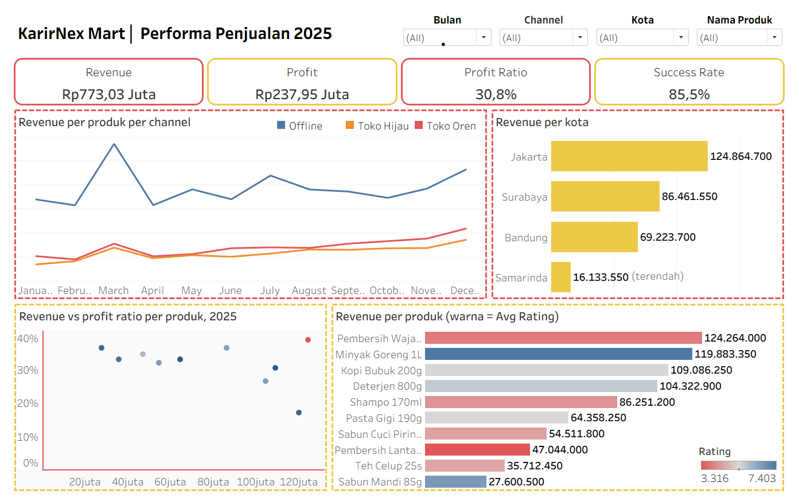

# Tableau Sales Performance Dashboard 2025

## Deskripsi Proyek

Proyek ini merupakan dashboard interaktif yang dibuat menggunakan **Tableau** untuk menganalisis performa penjualan KarirNex Mart selama tahun 2025.

Dashboard ini bertujuan untuk menyajikan informasi mengenai pendapatan, keuntungan, rasio keuntungan, dan keberhasilan transaksi penjualan. Visualisasi dibuat untuk membantu memahami performa penjualan berdasarkan produk, kota, dan saluran penjualan (*Sales Channel*).

## Tools

- Tableau
- Microsoft Excel

## Dataset

Dataset yang digunakan adalah data penjualan KarirNex Mart tahun 2025 dalam format Excel.

Data mencakup informasi transaksi penjualan yang digunakan untuk menganalisis beberapa aspek, seperti:
- Tanggal dan bulan transaksi
- Saluran penjualan (*Sales Channel*)
- Kota
- Nama produk
- Revenue dan Profit
- Rating produk
- Status transaksi

## Dashboard Preview

Klik gambar di bawah ini untuk melihat dashboard dalam ukuran lebih besar.

## Key Insights

Berdasarkan hasil analisis dashboard, diperoleh beberapa temuan utama sebagai berikut:

1. **Revenue Performance:** Total revenue selama tahun 2025 mencapai **Rp773,03juta**, dengan total profit sebesar **Rp237,95juta**.

2. **Sales Channel:** Channel dengan kontribusi revenue tertinggi adalah **Toko Offline** sebesar **Rp463,03juta**, sedangkan channel dengan kontribusi terendah adalah **Toko Hijau** sebesar **Rp141,13juta**.

3. **City Performance:** Kota dengan revenue tertinggi adalah **Kota Jakarta** sebesar **Rp124,86 juta**, menunjukkan kontribusi penjualan terbesar berasal dari wilayah tersebut.

4. **Product Performance:** Produk dengan revenue tertinggi adalah **Pembersih WAjah 100g** sebesar **Rp124,26juta**, dengan profit ratio tertinggi sebesar **39%**. Namun, produk ini memiliki rating rendah yaitu **3,88/10** sehingga perlu ditinjau kembali terkait kualitas produknya.

5. **Product Rating:** Produk dengan rata-rata rating tertinggi adalah **Minyak Goreng 1L** dengan rating **7,4/10**, dengan revenue sebesar **Rp120juta**. Namun, produk ini memiliki ratiio profit terendah yaitu **17%** sehingga perlu ditinjau kembali terkait harga jual produk.

## Dashboard Analysis

Dashboard menyajikan beberapa indikator dan visualisasi utama:

### 1. Key Performance Indicators (KPI)

Menampilkan ringkasan performa penjualan melalui beberapa indikator:
- **Revenue:** Total pendapatan penjualan.
- **Profit:** Total keuntungan.
- **Profit Ratio:** Persentase keuntungan terhadap pendapatan.
- **Success Rate:** Persentase keberhasilan transaksi.

### 2. Revenue per Product per Channel

Menampilkan tren pendapatan bulanan berdasarkan produk dan saluran penjualan, yaitu Offline, Toko Hijau, dan Toko Oren.

### 3. Revenue per City

Membandingkan pendapatan penjualan dari setiap kota untuk mengetahui distribusi pendapatan berdasarkan wilayah.

### 4. Revenue vs Profit Ratio per Product

Menampilkan hubungan antara pendapatan dan rasio keuntungan masing-masing produk untuk membantu mengevaluasi performa produk.

### 5. Revenue per Product based on Average Rating

Membandingkan pendapatan setiap produk dengan rata-rata rating produk untuk melihat gambaran performa penjualan dan penilaian pelanggan.

## Dashboard Features

Dashboard dilengkapi dengan filter interaktif yang memungkinkan pengguna melakukan eksplorasi data berdasarkan:
- Bulan
- Sales Channel
- Kota
- Nama Produk

Filter tersebut membantu pengguna melihat performa penjualan berdasarkan kategori yang dipilih.

## Repository Files

| File | Deskripsi |
|---|---|
| `Dashboard.png` | Preview dashboard |
| `Dashboard_Sales.twb` | File workbook Tableau |
| `Dataset_Tableau_KarirNexMart_2025.xlsx Day 2.xlsx` | Dataset penjualan |

## Kesimpulan

Melalui dashboard ini, data penjualan KarirNex Mart tahun 2025 disajikan dalam bentuk visualisasi interaktif yang memudahkan pemantauan performa penjualan.

Analisis dilakukan melalui indikator pendapatan, keuntungan, keberhasilan transaksi, serta perbandingan performa berdasarkan produk, kota, dan saluran penjualan.

Proyek ini menjadi salah satu bentuk penerapan kemampuan pengolahan, visualisasi, dan analisis data menggunakan Tableau untuk mendukung pemahaman terhadap performa bisnis.
